  

  <picture>
    <source media="(max-width: 768px) and (prefers-color-scheme: dark)" srcset="assets/tagline/mobile-dark.svg" />
    <source media="(max-width: 768px)" srcset="assets/tagline/mobile-light.svg" />
    <source media="(prefers-color-scheme: dark)" srcset="assets/tagline/desktop-dark.svg" />
    
  </picture>

<h2 align="center">Stack</h2>

<h3 align="center">Mobile</h3>

  &nbsp;&nbsp;&nbsp;&nbsp;&nbsp;&nbsp;&nbsp;&nbsp;&nbsp;

<h3 align="center">Web</h3>

  &nbsp;&nbsp;&nbsp;&nbsp;&nbsp;&nbsp;&nbsp;&nbsp;&nbsp;&nbsp;&nbsp;&nbsp;

<h3 align="center">Runtime &amp; Data</h3>

  &nbsp;&nbsp;&nbsp;&nbsp;&nbsp;&nbsp;&nbsp;&nbsp;&nbsp;&nbsp;&nbsp;&nbsp;

<h3 align="center">Tooling</h3>

  &nbsp;&nbsp;&nbsp;&nbsp;&nbsp;&nbsp;&nbsp;&nbsp;&nbsp;&nbsp;&nbsp;&nbsp;

<h2 align="center">Stats</h2>

  

  
  

  

  <picture>
    <source media="(max-width: 768px) and (prefers-color-scheme: dark)" srcset="assets/footer/mobile-dark.svg" />
    <source media="(max-width: 768px)" srcset="assets/footer/mobile-light.svg" />
    <source media="(prefers-color-scheme: dark)" srcset="assets/footer/desktop-dark.svg" />
    
  </picture>

  

